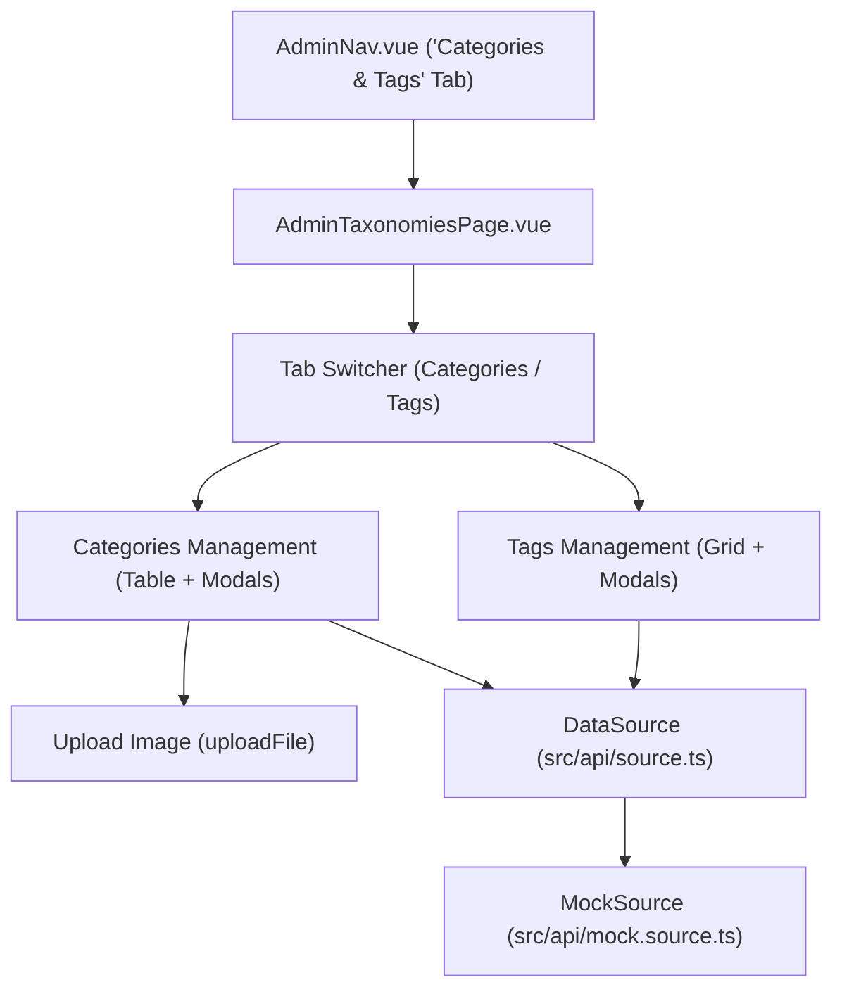

# Blogku Branding & Taxonomies Management (CRUD Categories & Tags)

| Metadata | Keterangan |
| :--- | :--- |
| **Status** | ✅ Stable |
| **Fase Arsitektur** | Fase 1 (Mock) & Fase 2 Ready |
| **Izin Minimum (RBAC)** | Admin (`manage_taxonomies` / `manage_settings`) |
| **Komponen Utama** | [AdminTaxonomiesPage.vue](file:///c:/Users/Administrator/Desktop/ncmaz-clone/frontend/src/pages/admin/AdminTaxonomiesPage.vue), [AdminNav.vue](file:///c:/Users/Administrator/Desktop/ncmaz-clone/frontend/src/components/admin/AdminNav.vue), [Brand.vue](file:///c:/Users/Administrator/Desktop/ncmaz-clone/frontend/src/components/layout/Brand.vue) |
| **Tanggal Ditambahkan** | 2026-10-23 |

---

## 1. Ringkasan & Tujuan Fitur
Fitur ini memperbarui identitas dan branding proyek dari nama awal **Ncmaz** menjadi **Blogku**, serta menyediakan modul administrasi khusus untuk manajemen klasifikasi editorial (**Categories** dan **Tags**) dengan kemampuan penuh **CRUD (Create, Read, Update, Delete)**.

### Masalah yang Diselesaikan:
1. **Rebranding**: Memperbarui branding platform secara menyeluruh menjadi **Blogku** pada logo inisial ("B"), header, footer, metadata SEO OpenGraph/Twitter, structured data JSON-LD, mock users, dan email domain.
2. **Taxonomies Management**: Menyediakan portal bagi admin untuk membuat, mengubah, menghapus, mengunggah gambar kategori, serta mengorganisasi topik dan tag artikel secara terstruktur tanpa perlu manipulasi database manual.

---

## 2. Alur Pengguna (User Flow)

### 2.1 Manajemen Kategori (CRUD)
1. **Melihat Kategori**:
   - Admin membuka `/admin/taxonomies` dan memilih tab **Categories**.
   - Admin dapat melihat tabel daftar seluruh kategori lengkap dengan thumbnail cover, nama, slug URL, deskripsi, status subkategori, serta jumlah artikel terkait.
   - Admin dapat mencari kategori secara instan menggunakan kolom search.
2. **Membuat Kategori**:
   - Admin menekan tombol **"New Category"**.
   - Modal muncul: mengisi nama kategori (slug otomatis di-generate), deskripsi, memilih parent category, dan mengunggah gambar cover atau memasukkan URL gambar.
   - Klik **"Create Category"** -> sistem memvalidasi dengan `categorySchema` (Zod + sanitize) dan menyimpan ke DataSource.
3. **Mengubah Kategori**:
   - Admin menekan ikon pensil (*Edit*) pada baris kategori.
   - Modal muncul dengan data terisi -> admin mengubah field -> klik **"Save Changes"**.
4. **Menghapus Kategori**:
   - Admin menekan ikon sampah (*Delete*) -> muncul modal konfirmasi peringatan.
   - Klik **"Delete Permanently"** -> kategori dihapus secara permanen.

### 2.2 Manajemen Tag (CRUD)
1. **Melihat Tag**:
   - Admin memilih tab **Tags**.
   - Menampilkan grid kartu tag dengan format `#tagname`, slug, dan jumlah artikel.
2. **Membuat Tag**:
   - Admin menekan tombol **"New Tag"** -> mengisi nama tag dan slug -> klik **"Create Tag"**.
3. **Mengubah Tag**:
   - Menekan ikon edit pada tag -> mengubah nama atau slug -> klik **"Save Changes"**.
4. **Menghapus Tag**:
   - Menekan ikon hapus pada tag -> konfirmasi penghapusan -> tag dihapus dari DataSource.

---

## 3. Arsitektur & Komponen Terkait



### File yang Dibuat & Dimodifikasi:
- **`frontend/src/pages/admin/AdminTaxonomiesPage.vue`**: Halaman utama portal administrasi taksonomi untuk CRUD categories dan tags lengkap dengan modal dialog, pencarian, validasi Zod, dan upload gambar.
- **`frontend/src/components/admin/AdminNav.vue`**: Menambahkan tab menu navigasi `Categories & Tags` (`/admin/taxonomies`) dengan ikon `FolderTree`.
- **`frontend/src/router/index.ts`**: Mendaftarkan rute `/admin/taxonomies` dengan proteksi guard `requiresAuth: true` dan permission `manage_taxonomies`.
- **`frontend/src/lib/permissions.ts`**: Menambahkan permission `manage_taxonomies` khusus peran `admin`.
- **`frontend/src/lib/validation.ts`**: Menambahkan `categorySchema` dan `tagSchema` dengan sanitasi anti-XSS (`sanitizePlainText`, `sanitizeUrl`).
- **`frontend/src/api/source.ts` & `frontend/src/api/types.ts`**: Mendefinisikan kontrak interface `TagInput` dan metode CRUD DataSource: `createCategory`, `updateCategory`, `deleteCategory`, `createTag`, `updateTag`, `deleteTag`.
- **`frontend/src/api/mock.source.ts`**: Implementasi penyimpanan lokal (localStorage) untuk persistensi kategori dan tag.

---

## 4. Kontrak Data & TypeScript Types

```typescript
export interface Category {
  id: string
  name: string
  slug: string
  description: string
  image: string
  parentId: string | null
  postCount?: number
}

export interface CategoryInput {
  id?: string
  name: string
  slug?: string
  description?: string
  image?: string
  parentId?: string | null
}

export interface Tag {
  id: string
  name: string
  slug: string
  postCount?: number
}

export interface TagInput {
  id?: string
  name: string
  slug?: string
}
```

### Skema Validasi Zod:
```typescript
export const categorySchema = z.object({
  name: z.string().trim().transform(sanitizePlainText).refine(v => v.length >= 2),
  slug: z.string().trim().optional().transform(v => v ? sanitizePlainText(v).toLowerCase() : undefined),
  description: z.string().trim().optional().transform(v => v ? sanitizePlainText(v) : ''),
  image: z.string().trim().optional().transform(v => v ? sanitizeUrl(v) : ''),
  parentId: z.string().nullable().optional(),
})

export const tagSchema = z.object({
  name: z.string().trim().transform(sanitizePlainText).refine(v => v.length >= 2),
  slug: z.string().trim().optional().transform(v => v ? sanitizePlainText(v).toLowerCase() : undefined),
})
```

---

## 5. Keamanan & Otorisasi
- **RBAC**: Aksi penambahan, pengubahan, dan penghapusan kategori dan tag dibatasi secara ketat hanya untuk pengguna dengan role **admin** melalui pemeriksaan `user.role === 'admin'` pada data source dan route guard `manage_taxonomies`.
- **Sanitasi Anti-XSS**: Nama kategori/tag dan deskripsi dibersihkan menggunakan `sanitizePlainText`, dan URL gambar divalidasi dengan `sanitizeUrl` untuk mencegah injeksi `javascript:` atau manipulasi atribut berbahaya.

---

## 6. Pengujian & Verifikasi

### 6.1 Uji Otomatis
```bash
cd frontend
npm run test
```
*Hasil*: 7 test files, 60 tests passed (termasuk verifikasi unit test untuk operasi create, update, delete kategori dan tag).

### 6.2 Uji Typecheck
```bash
cd frontend
npm run typecheck
```
*Hasil*: Lolos bersih tanpa error TypeScript.

### 6.3 Verifikasi Manual
1. Masuk ke halaman login (`/login`) dengan akun admin:
   - Username: `admin`
   - Password: `password`
2. Buka menu **Admin Portal** di pojok kanan atas atau akses `/admin/taxonomies`.
3. Coba buat kategori baru (mis. "Artificial Intelligence").
4. Coba upload gambar cover kategori atau masukkan link Unsplash.
5. Coba edit kategori atau ubah slug.
6. Coba buat, edit, dan hapus tag di tab **Tags**.
7. Verifikasi perubahan langsung tercermin di navbar kategori dan tag cloud.
